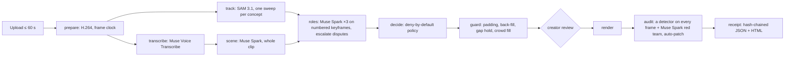

# Sigmora Safe Cut

**Publish real-world footage without exposing the people who never agreed to be in it.**

Safe Cut takes a clip filmed in public and decides, from context, what shouldn't be published: bystanders (as opposed to the people in the story), children, number plates, and screens and documents that show personal data. Muse Spark reasons about who is part of the story. SAM 3.1 keeps each hidden thing covered on every frame. Anything uncertain stays hidden by default. A second pass audits the final render before anything goes live. The creator approves every decision and gets a hash-chained privacy receipt.

**Scope: Safe Cut redacts the picture, not the soundtrack.** The audio is kept as recorded, so a bystander's voice, or a name or number said aloud, is still heard; the result page's captions come from the same unredacted transcript. The receipt says so too. Mute or edit the audio yourself when that matters.

Built for the **Meta Global AI Developer Hackathon** (Startup track, "Build for Your World"), on the Meta Model API.

> **Status.** The whole pipeline runs end to end in replay on a **synthetic** demo clip: drawn shapes, with recorded answers generated from the clip's ground truth rather than returned by Meta. Live runs on consented footage, the deployed service and the reported numbers wait on the owner inputs in [`BLOCKED.md`](BLOCKED.md). Every line of product code here is dated after the kickoff (Oct 26, 12:00 ET).

- **Live demo:** `https://safecut.sigmora.org`, once the Vercel project and the Modal deploy exist (`BLOCKED.md`). The landing page replays the demo job, labelled as a demo, and **Try it** takes a judge access code.
- **Video:** linked from `docs/SUBMISSION.md` once recorded.

## How it works



Each stage reads and writes one JSON contract in the job directory (`docs/ARCHITECTURE.md` §3, `safecut/contracts.py`), so every stage can be re-run, replayed or tested alone. `validate_job_dir` cross-checks all of them: every track sits in exactly one decision item; every hidden track is covered on every frame it is visible; children are locked hides; the receipt matches the job.

## What each Meta model does here

| Model | Its job in Safe Cut | Why this model and not something else |
|---|---|---|
| **SAM 3.1** (`sam-3.1`) | Tracks every face, person, plate, screen, phone, document and name badge, one request per concept, plus the phrases the miss loop proposes. Its masks become the redaction: faces and heads hidden with a coarse mosaic; plates, screens and documents covered solid | The only model in the stack that gives pixel masks with stable IDs through a whole video. A track that is lost and found again gets a new ID and starts hidden |
| **Muse Spark** (`muse-spark-1.3`) | The scene pass (who is in the story, from the whole clip and its transcript); the role pass (three independent votes per tracked person on Set-of-Mark keyframes, where SAM's numbered boxes are drawn on the frame); escalation at maximum effort on disputes; the miss loop (what SAM didn't track); the red-team audit of the final render | Context, not detection: "the woman who introduced herself at 0:03" versus "someone walking past". Structured output with `store: false`, and image and video input |
| **Muse Voice Transcribe** (`muse-voice-transcribe-1.0`) | A diarized transcript with turn times on the prepared clip's clock | Speech is the strongest evidence that someone is a participant ("Hi, I'm Amina"); Meta's docs call Spark's audio understanding degraded |
| **Muse Spark** (`muse-spark-1.2`) | The fallback speech path through the video soundtrack, used only when Voice Transcribe is unavailable | Keeps the speech evidence without a second vendor |
| **Muse Spark Open** (`meta-models/muse-spark-open-1026`, on Baseten) | An optional open-weight second opinion in the audit, for consented jobs only | The Best Build on Meta Open-Weight Models path. It is advisory, never a reason to publish, and its spend is reported apart |
| **EgoBlur Gen 2** (Meta's open face and plate detector) | The every-frame auditor of the rendered video, on a Modal GPU (`egoblur_detect`, L4 or T4) with Meta's weights, hash-checked | A detector that knows nothing of our decisions, checking the output we would publish. It needs a GPU (on a CPU it would take most of an hour per clip), so the slim API container sends each scan to a GPU function that reads the render from a handoff Volume. If the GPU can't answer, OpenCV's YuNet face detector runs instead (plates by the red team), and `audit.json` and the receipt name the detector and the GPU that actually ran |

Model IDs come from the environment (`safecut/config.py`), with Standard model IDs only, `store: false`, and every uploaded file deleted after use. Every API attempt writes a line to the job's `cost.jsonl`, and the receipt's cost is checked against it.

## Results

From [`eval/RESULTS.md`](eval/RESULTS.md), which `eval/report.py` builds from the committed runs in `eval/results/` only. **The only runs so far are on the synthetic demo clip.** They show that the pipeline, the baselines and the metrics work end to end; they say nothing about model quality, because the "model" answers were generated from the clip's ground truth. Reported numbers come from the frozen test split, run on the owner's machine once the key and labels exist.

<!-- results:start -->
| Method (dev split, synthetic) | Recall | Exposure | Leak bursts | Over-blur |
|---|---|---|---|---|
| Blur every face (SAM 3.1 `face`, all hidden) | 40.0% | 59.3% | 3 | 100.0% |
| OpenCV YuNet face detector on every frame (EgoBlur weights not installed) | 0.0% | 100.0% | 5 | 0.0% |
| Detector only (SAM 3.1 classes, no Muse Spark) | 80.0% | 10.1% | 1 | 100.0% |
| Muse Spark keyframe boxes, no tracking | 60.0% | 37.5% | 12 | 100.0% |
| **Safe Cut (full)** | 100.0% | 0.0% | 0 | 0.0% |
| Safe Cut without the audit pass | 100.0% | 0.0% | 0 | 0.0% |
<!-- results:end -->

The honest failures on this clip: the YuNet baseline finds no drawn face at all (they aren't faces), so it exposes everything. Blur-every-face hides both participants. Safe Cut's over-blur reads zero here, but deny-by-default still costs the guest a moment: he leaves and comes back, the tracker gives the return a new ID, and with the policy auto-approved that span stays hidden until a creator merges it (one tap in review). It is too short to count under the over-blur threshold, and `per_clip.csv` in each run shows the guest's hidden frames. Recall, exposure, leak bursts and over-blur are defined in `eval/RESULTS.md` and tested in `tests/test_metrics.py`.

## Production notes

- **Service:** FastAPI on Modal (`deploy/modal_app.py`). It scales to zero when no one uses it and runs at most one API container, because the per-IP rate limits and the spend ledger are in-process; the pipeline runs in that container's worker threads, and each queued job holds the container up through an input of its own until the job stops (a container that dies anyway is replaced, and its jobs resume). EgoBlur runs on a separate GPU function. Job folders live on a Volume. Sizes, decisions and cost: `docs/DEPLOY-COSTS.md`.
- **Access:** judge and public access codes, plus pilot, recording and owner codes, each with its own validity window, and Bearer service keys for Sigmora. A code is bound to its job by a non-secret ID, so revoking it (removing it from `SAFECUT_ACCESS_CODES` and redeploying) stops its jobs' paid work at the next start, render, audit, re-queue or restart, which each re-check the code; an analysis already running finishes, within the per-clip and daily caps.
- **Spend caps,** checked before any paid work. The values are in `eval/RESULTS.md`'s service limits:
  - a per-clip cap;
  - a daily cap for judge and public codes, reset at 00:00 UTC;
  - per-code caps and a shared pilot pool;
  - a worst-case estimate refused up front.
- **Uploads:** signed `PUT` URLs, valid 15 minutes, for the exact size and type declared; up to 60 s and 150 MB.
- **Deletion:** every job is deleted within 24 h 15 min of being created (its 24-hour lifetime plus at most one 15-minute sweep), by a cron and an in-process sweep, and any job past its deletion time is refused and deleted on sight. `DELETE /v1/jobs/{id}` works in every state of a creator's job (the pinned demo job is read-only); a stage still running finishes its current call (still under the per-clip cap) and stops before the next one, and anything it wrote after the delete is removed as soon as it returns.
- **Replay mode:**
  - it reads the saved responses in `raw/` and refuses every outbound connection: process-wide for the CLI and for a demo-mode server, and per stage, in a child process, when a live server precomputes the demo job;
  - every response says `mode: "replay"`, and `synthetic: true` when the recordings are synthetic;
  - the web app labels both.
- **The receipt:** every decision, why it was made and who made it, the audit's counts, which model did what, and how data was handled. It is hash-chained (`sha256(prev_hash + canonical body)`) and is also rendered as self-contained HTML.
- **Checks:** `bash scripts/entry-check.sh` runs the whole entry from a fresh clone:
  - the Python and web suites;
  - every stage in replay;
  - the offline end to end, scored against ground truth;
  - the safety properties at 2000 examples each;
  - the API flow;
  - a real-browser run against the local API, with axe;
  - the deploy files, eval, docs and hygiene.

  `bash scripts/deploy-check.sh <api-url> <web-url>` smoke-tests a deployment.

## Run it yourself

Needs the Python version `pyproject.toml` pins, with [uv](https://docs.astral.sh/uv/). Everything below is offline: replay reads recorded responses and the network is blocked.

<!-- fresh-clone:start -->
```bash
uv sync --locked
uv run safecut run fixtures/clips/SC-A-91-synthetic-20261030.mp4 --out "$(mktemp -d)/demo" --replay --auto-approve-policy
uv run python eval/run.py --split dev --variant full --replay --results-dir "$(mktemp -d)"
```
<!-- fresh-clone:end -->

`safecut run` prints each stage and writes `redacted.mp4`, `audit.json`, `receipt.json` and `receipt.html` to the job folder. Without `--auto-approve-policy` it stops for review (`safecut approve --job <dir> && safecut publish --job <dir> --replay`; leave out `--replay` for a live job). Single stages run with `safecut <stage> --job <dir> --replay`. With `MODEL_API_KEY` set and without `--replay`, the same commands call Meta.

The API runs with `uv run uvicorn --factory safecut.api.app:create_app --no-proxy-headers` (set `SAFECUT_REPLAY=1` for demo mode). Behind a proxy, drop `--no-proxy-headers` only if that proxy overwrites `X-Forwarded-For`, or set `SAFECUT_TRUST_PROXY=1` as the Modal deploy does; `scripts/deploy-check.sh` tests that forged headers can't dodge the rate limit. The web app is documented in [`web/README.md`](web/README.md), and the routes are in `docs/UI-SPEC.md` §8.

## What existed before Oct 26

Safe Cut is a new, standalone codebase, written during the event. It plugs into **Sigmora** (sigmora.org), our existing content platform for creators, which before the event already had:
- Clip preparation and an object-tracking provider interface (a fal SAM 3 provider that never ran live).
- A redaction layer (blur, pixelate or solid boxes on source-anchored tracks) and a renderer.
- An agent action with priced approval cards, an editor tracking UI, and a publishing queue.

None of that code is copied here. Safe Cut is built to be called by Sigmora as its host app, through service keys (`docs/DESIGN.md` §3). Before the kickoff this repo held design documents only.

## Docs

| File | What |
|---|---|
| [docs/ARCHITECTURE.md](docs/ARCHITECTURE.md) | The architecture, the data contracts between stages, models and config |
| [docs/AGENTIC-LOOP.md](docs/AGENTIC-LOOP.md) | The closed loop, step by step, on one traced job |
| [docs/DESIGN.md](docs/DESIGN.md) | The pipeline design and the research behind it |
| [docs/EVAL.md](docs/EVAL.md) | The labelled dataset, metrics, baselines and protocol |
| [docs/UI-SPEC.md](docs/UI-SPEC.md) | The web app and the API's routes |
| [docs/SUBMISSION.md](docs/SUBMISSION.md) | The submission form's fields and the judges' testing steps |
| [BLOCKED.md](BLOCKED.md) | What waits on the owner, with exact steps |

## License

MIT. See [LICENSE](LICENSE).
